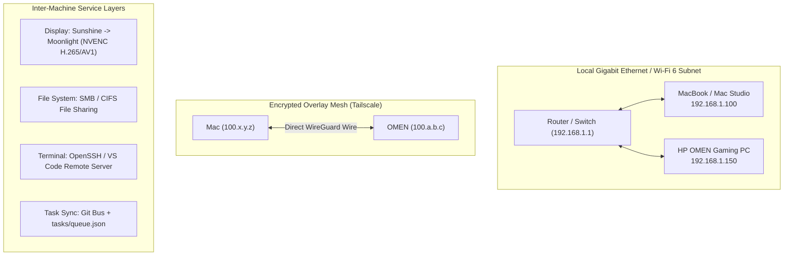

# Dual-Node System Architecture

This document specifies the technical design, network topology, communication layers, and concurrency controls powering the Mac Commander + HP OMEN Worker Node setup.

---

## 1. Network Topology

### Protocol Breakdown

| Protocol | Port(s) | Role | Latency Profile |
| :--- | :--- | :--- | :--- |
| **Sunshine / Moonlight** | 47984-47990 UDP/TCP | Low-latency 60-120fps 4K video stream from NVIDIA NVENC to macOS client. | < 5ms (Local LAN) |
| **SMB (Server Message Block)** | 445 TCP | Transparent file mounting. Windows `D:\RenderQueue` mounted at `/Volumes/RenderQueue`. | Gigabit throughput (~110 MB/s) |
| **OpenSSH** | 22 TCP | Command execution, WSL2 shells, headless automation, VS Code Remote. | Instantaneous |
| **ComfyUI / WebUI** | 8188 / 7860 TCP | Web interfaces for local generative models running on OMEN GPU. | Browser-native |
| **Wake-on-LAN** | 9 UDP | UDP broadcast magic packet to wake OMEN from S3/S5 sleep state. | Sub-second |

---

## 2. Display Pipeline: Sunshine + Virtual Display

To make remote operation feel indistinguishable from working directly on the Mac:
1. **Virtual Display Driver (IddSampleDriver / MikeTheTech)** creates a virtual monitor on Windows matching your exact Mac resolution (e.g. 3024×1964 or 2560×1600 at 16:10 aspect ratio).
2. **NVIDIA NVENC Hardware Encoder** captures the desktop frame buffer in hardware with zero CPU impact.
3. **Moonlight on macOS** decodes using Apple Silicon hardware video decoders, rendering in a borderless native window or separate macOS Space.

---

## 3. Storage & Path Translation Strategy

Cross-platform rendering often breaks when asset paths differ between operating systems.

### Absolute vs Relative Paths
- **Rule 1 (Blender & 3D)**: Always save projects with relative paths enabled (`//textures/albedo.png`).
- **Rule 2 (DaVinci Resolve)**: Under *Preferences > Media Storage*, enable **Path Mapping**:
  - Mac Path: `/Volumes/RenderQueue/`
  - Windows Path: `D:\RenderQueue\`
- **Rule 3 (Code / Datasets)**: Python scripts must use `pathlib.Path` or `os.path.join` and avoid hardcoded drive letters.

---

## 4. Concurrent Antigravity Execution Model

When both instances of Antigravity operate at the same time:

1. **Branch Isolation**:
   - Mac Antigravity operates on `agent/mac` or task-specific branches (e.g., `feat/frontend-ui`).
   - Windows Antigravity operates on `agent/win` or compute branches (e.g., `feat/cuda-pipeline`).
2. **Task Queue Semantics**:
   - Work items placed into `tasks/queue.json` are atomic.
   - Status flows sequentially: `pending` -> `in_progress` -> `completed` / `failed`.
   - Results are written as standalone JSON records in `tasks/results/<taskId>.json` to eliminate concurrent write collisions on the queue file.
