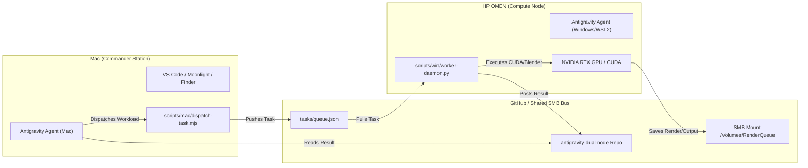

# Antigravity Dual-Node (Mac Commander + HP OMEN Worker)

A synchronized, concurrent multi-machine architecture designed for running Google Antigravity across a **Mac (Commander & Daily Driver)** and an **HP OMEN Windows PC (Dedicated GPU / CUDA / Render Node)**.

---

## ⚡ Overview

| Role | Machine | OS | Primary Responsibilities |
| :--- | :--- | :--- | :--- |
| **Commander** | Apple Silicon Mac | macOS | Front-end UI, rapid prototyping, chat interaction, code editing, media review, task dispatch. |
| **Worker Node**| HP OMEN | Windows 11 + WSL2 | Heavy CUDA pipelines, Blender renders, ComfyUI/Diffusers generation, local LLM fine-tuning/eval, video transcode. |

This repository acts as the **bridge and coordination bus** between both machines. It includes:
1. **Concurrent Git Protocol**: Safe branch isolation (`agent/mac` vs `agent/win`) and lock-free coordination so both Antigravity instances can work in parallel without merge conflicts.
2. **Task Queue & Results Bus**: Asynchronous job submission (`tasks/queue.json` and `tasks/results/`) allowing the Mac agent to offload heavy workloads to the OMEN GPU.
3. **Remote Access & Automation**: Production setup scripts for Wake-on-LAN, SMB network shares, Tailscale, Sunshine + Moonlight streaming, and SSH connectivity.

---

## 🚀 Quick Start

### 1. Setup Mac (Commander)
```bash
# Clone the repository
git clone https://github.com/ronkenx9/antigravity-dual-node.git
cd antigravity-dual-node

# Configure environment
cp .env.example .env
# Edit .env with your OMEN IP and MAC address

# Run verification suite
npm test
```

### 2. Setup HP OMEN (Worker)
Follow the step-by-step instructions in [`WINDOWS_SETUP.md`](WINDOWS_SETUP.md):
1. Install Sunshine + Virtual Display Driver (for native Retina streaming to Moonlight on Mac).
2. Configure SMB folder sharing (`RenderQueue`).
3. Enable Wake-on-LAN in the OMEN BIOS.
4. Run the background worker daemon:
   ```cmd
   python scripts\win\worker-daemon.py
   ```

---

## 🔄 Concurrent Antigravity Workflow

When running Antigravity simultaneously on both systems:



See [`AGENTS.md`](AGENTS.md) for detailed guidelines on concurrent pair-programming across both machines.

---

## 🛠️ Included Tools & Scripts

- `scripts/mac/wake-omen.sh`: Wakes up the HP OMEN remotely over the network using Wake-on-LAN.
- `scripts/mac/mount-omen.sh`: Instantly connects the Mac Finder to the OMEN's SMB shared storage.
- `scripts/mac/dispatch-task.mjs`: Dispatches render and compute jobs to the OMEN worker queue.
- `scripts/mac/sync.sh`: Performs conflict-free automated git rebasing across machines.
- `scripts/win/worker-daemon.py`: Autonomous daemon monitoring the queue and executing GPU tasks.
- `scripts/win/check-gpu.py`: Deep diagnostics verifying NVIDIA SMI, VRAM usage, and PyTorch CUDA.

---

## 📚 Documentation Directory

- [`ARCHITECTURE.md`](ARCHITECTURE.md): Network topology, streaming protocols, and latency considerations.
- [`WINDOWS_SETUP.md`](WINDOWS_SETUP.md): Windows 11 & WSL2 step-by-step configuration.
- [`MAC_SETUP.md`](MAC_SETUP.md): macOS client setup, Moonlight profile, and SMB configuration.
- [`AGENTS.md`](AGENTS.md): Operational rules for simultaneous Antigravity agent pairs.
